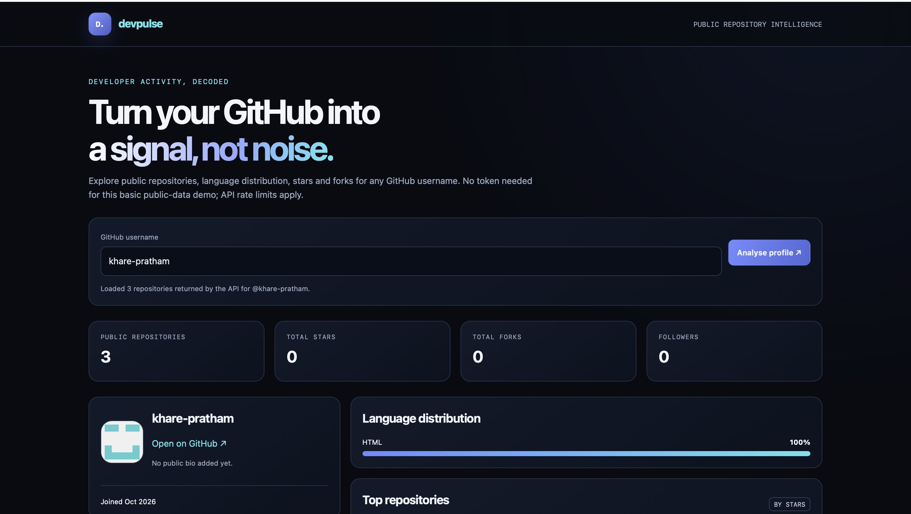

# DevPulse — GitHub Analytics Dashboard

[](https://github.com/khare-pratham/devpulse/actions/workflows/devpulse-tests.yml) [](https://khare-pratham.github.io/devpulse/)

> Explore public GitHub profile and repository data through a responsive analytics dashboard.

**Live demo:** https://khare-pratham.github.io/devpulse/

## Overview

DevPulse is a static browser app that uses GitHub's public REST API to show profile details, public repository totals, stars, forks, language distribution estimates and top repositories. It needs no API token or backend.

## Features

- Search public GitHub usernames with client-side validation.
- Loading feedback and clear messages for missing users, rate limits, server failures, network failures, slow responses and invalid API responses.
- Profile metrics, language distribution estimate and top repositories.
- Safe text rendering and validated external links.
- Warning when the public API response does not include all of a profile's public repositories.
- Responsive dark interface, keyboard focus styles and reduced-motion support.

## Tech stack

`HTML5` · `CSS3` · `Vanilla JavaScript` · `GitHub REST API` · `Node.js test runner` · `Playwright` · `GitHub Actions`

## How metrics work

- Public repository count comes from the GitHub user profile.
- Stars and forks are summed from repositories returned by the API request.
- Language distribution is estimated by summing each returned repository's size metadata by its primary language. It is not a line-of-code breakdown.
- The top eight repositories are sorted by star count.
- The public API request fetches up to 100 repositories. For larger accounts, totals based on fetched repositories may be incomplete; the UI warns about this.

## Run locally

Open `index.html` in a browser. If browser restrictions interfere, run a local server from this directory:

```bash
python3 -m http.server 8000
```

Then open http://localhost:8000.

## Run automated tests

Requires Node.js 18 or later; the GitHub Actions workflow uses Node.js 22.

```bash
node --check devpulse-core.js
node --test tests/devpulse-core.test.cjs
node tests/devpulse-e2e.mjs
```

## Test checklist

- [x] Browser test: search for a valid username and verify profile metrics and repository links.
- [x] Browser test: search for a missing username and verify a clear error.
- [x] Browser test: reject an invalid username before sending a request.
- [x] Browser test: verify API rate-limit messaging.
- [x] Browser test: verify repository counts, stars and forks against mocked API data.
- [ ] Manual follow-up: test profiles with no bio or language metadata.
- [x] Browser test: disclose incomplete data when results hit the 100-repository cap.
- [ ] Manual follow-up: check keyboard navigation and a narrow mobile viewport.

## Known limitations

- Unauthenticated GitHub API rate limits apply.
- Only the first 100 updated repositories are loaded; no pagination yet.
- Language distribution uses repository size metadata, not exact lines of code.
- Only public data is accessible; private repositories are not supported.
- No historical activity chart, persistent cache or server-side proxy.

## Potential improvements

- Add pagination and request caching.
- Extend browser coverage for profiles with missing bio or language metadata.
- Add a small accessibility audit and cross-browser test matrix.

## Screenshot



## Project status

Portfolio project. Implemented features and known limitations are documented separately from proposed improvements.
